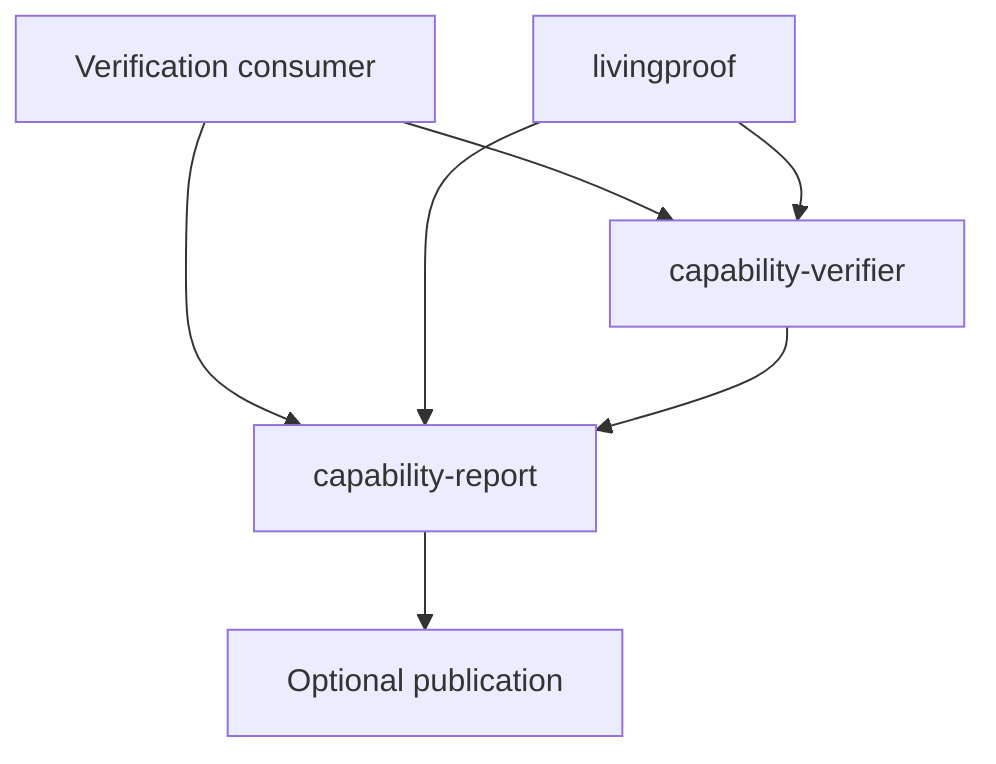
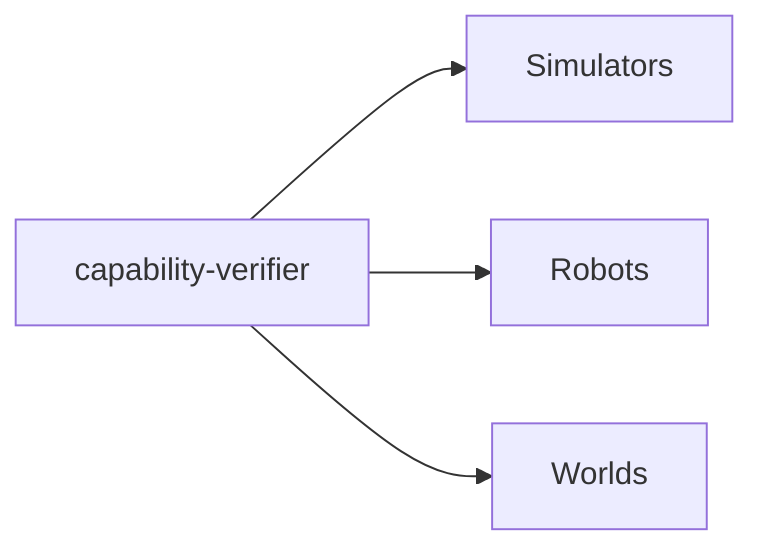
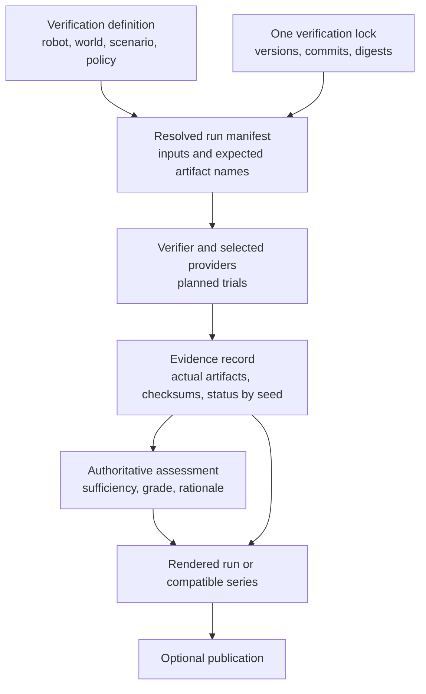

<!-- SPDX-License-Identifier: CC-BY-4.0 -->

# Verification architecture

Living Proof Labs verification turns a selected robot configuration, world,
scenario, and policy into retained evidence, an authoritative assessment, and
a report people can inspect. The same contracts support local development,
automated workflows, and future customer-owned verification projects.

This page describes the delivered architecture (as of November 2026) and its
tracked migrations. It is not a claim that every integration or hardware
deployment is complete: physical robots are not supported, and Gazebo is not yet
connected.

## Start here

| Need | Read |
| --- | --- |
| Find the component responsible for a task | [Responsibilities](#responsibilities) |
| Follow a run from selection to publication | [Run and series flow](#run-and-series-flow) |
| Understand what is delivered now | [Current implementation](#current-implementation) |
| Track the remaining migrations | [Migration work](#migration-work) |

## Responsibilities

Who invokes the shared tools:

What `capability-verifier` draws on to run trials:

The table below names each component's repository and responsibility;
`capability-report` is `livingproof-capability-report`, the robots are the robot
repositories and the worlds are `livingproof-worlds`.

Arrows show a dependency or supplied input, not ownership of every artifact.
The consumer is intentionally thin: it selects a baseline and publishes
results; it does not copy the execution, evaluation, or rendering engines.

| Component | Responsibility | Boundary |
| --- | --- | --- |
| `.github` | Organization view, inventory, and this architecture | Does not become a verification engine |
| Verification consumer | One selected baseline, verification lock, run/series selection, and publication settings | Delivered as [`livingproof-verification`](https://github.com/Living-Proof-Labs/livingproof-verification), which publishes the [robot reports](https://docs.livingprooflabs.com/livingproof-verification/); [verifier #20](https://github.com/Living-Proof-Labs/capability-verifier/issues/20) (verifier-owned lock) is still open |
| Robot repository | Robot manifest, adapter, assets, feature flags, simulator compatibility, and contract tests | Does not own the cross-robot verification baseline after the manifest migration |
| `livingproof` | Discovery, installation, and local invocation of installed tools | Is not a required hop for an automated workflow |
| `capability-verifier` | Resolve the lock, execute trials, retain evidence, and produce authoritative grades and comparisons | Evaluator implementation may become more internally separated; it remains the authority |
| Simulator provider | Physics execution and observations | Does not grade capability |
| `livingproof-worlds` | Versioned fixtures and engine representations | Adapter code performs engine conversion |
| `livingproof-capability-report` | Render the verifier's stored run and series assessments (render-only since [v2.0.0](https://github.com/Living-Proof-Labs/livingproof-capability-report/releases/tag/v2.0.0); [#30](https://github.com/Living-Proof-Labs/livingproof-capability-report/issues/30) is done) | Must not recompute a grade or invent missing evidence |
| `livingproof-common` | Identity and build provenance | Is not a plugin manager, runner, or evaluator |

### Who owns what

In short: you build the robot software, Living Proof Labs provides the
verification workflow, and you get evidence of what it can do, version after version.

| Part | Owned by | Notes |
| --- | --- | --- |
| Controller or policy | Customer | The software under test; it runs inside the simulated robot during each trial |
| Robot repository: manifest, adapter, assets and contract tests | Customer | The robot manifest declares configurations and simulator compatibility; the thin adapter connects the controller to the simulator provider |
| Verification consumer: definitions and verification lock | Customer | The lock pins the reviewed versions, commits and digests of every tool, world and robot input; changing it is a reviewed change |
| CI runners | Customer | The reusable workflow runs on the caller's GitHub Actions runners (`ubuntu-24.04`, CPU only) |
| Evidence and reports | Customer | Evidence bundles and rendered reports are stored as workflow artifacts in the caller's repository; publishing to GitHub Pages is optional |
| Capability specs, worlds, simulator providers | Living Proof Labs (open source) | `robot-capability-specs`, `livingproof-worlds`, `livingproof-sim-*` |
| Verifier, grading policy and reusable workflow | Living Proof Labs (open source) | `capability-verifier`, including `walk-hallway.yml` |
| Reporter | Living Proof Labs (open source) | `livingproof-capability-report`, render-only |

The reusable workflow's main inputs: `repository` and `ref` (the robot
repository to verify, defaulting to the caller), `configurations` (which lock
configurations to run, defaulting to all), `artifact-prefix`, `check` (lint,
profile validation and the robot repository's tests), `comment` (post the
result on same-repository pull requests) and `media`. Its outputs name the
configurations that ran and the download pattern for their reports.

Where your code goes: the reusable workflow checks out your robot repository
only on your own workflow run's runners, and Living Proof Labs runs no
infrastructure that receives or pulls it. The workflow does not cache your
repository, and it does not upload source files as artifacts. What it does
upload, as workflow artifacts in your repository, are test results, evidence
(trial observations, your lock, robot and configuration profiles, the source
commit, and any extra fields your adapter's `environment()` returns), verifier
decisions, recordings and rendered reports; the optional pull request comment
posts the report there too. Anyone who can read your repository's workflow
runs can read these, so on a public repository they are public, as are the job
logs. Keep anything confidential out of adapter output, profiles and log
messages.

GitHub Pages is an optional publication destination, not a shared-tool
dependency. Shared capabilities never depend back on a consumer.

## Run and series flow

| Record | What it records | Authority |
| --- | --- | --- |
| Verification definition | Selected robot configuration, world, scenario, policy, and series intent | Consumer |
| Verification lock | Reviewed versions, commits, digests, and compatibility choices | Consumer (`livingproof-verification/verifications/*.lock.json`) |
| Resolved run manifest | Exact executable inputs, planned trial identities, and **expected** media/evidence-link artifact names | Verifier |
| Evidence record | **Actual** artifacts, checksums, timestamps, and pass, missing, or error status for every planned seed | Providers and verifier |
| Assessment | Evidence sufficiency, authoritative grade, rationale, and comparison result | Verifier and its evaluators |
| Report | A supplied assessment and linked provenance for one run or a declared compatible series | Reporter |

Pipeline completion, evidence sufficiency, and a capability grade are different
signals. Planned trial count remains the denominator: a missing or errored
trial is listed by seed and is not silently removed from a series.

An evidence checksum, lock hash, and source-run link preserve provenance after
an Actions artifact expires. They do not make expired evidence retrievable, so
the published reports keep their own copies of the evidence they link
([livingproof-verification #11](https://github.com/Living-Proof-Labs/livingproof-verification/issues/11),
done).

Series comparison requires compatible inputs, versions, metrics, and
missing-trial treatment. Equal random seeds across engines do not prove equal
physics or results. Simulation evidence applies only to its declared context;
it never authorizes physical deployment.

## Current implementation

The verification consumer is delivered. On every push to `main`,
[`livingproof-verification`](https://github.com/Living-Proof-Labs/livingproof-verification)
calls the verifier's pinned reusable `walk-hallway.yml` workflow for each reviewed
definition and lock, then publishes the
[robot reports](https://docs.livingprooflabs.com/livingproof-verification/) to
GitHub Pages: the latest grade, run history and provenance per robot and variant.
The [live index](https://docs.livingprooflabs.com/livingproof-verification/) lists
which robots and variants are published and their latest grades. `capability-verifier`
grades and writes the assessment into the bundle; `livingproof-capability-report`
(render-only since v2.0.0) only validates and renders it.

The robot repositories (G1, Go1, T1) also call the same reusable workflow from
their own CI. `livingproof` remains the local discovery, installation, and
invocation layer; its local path and the reusable workflow use the same contracts
and verification engine.

### Historical snapshot (October 2026)

Before the consumer existed, three robot repositories were the only automated
entry points: G1 [`21c9131`](https://github.com/Living-Proof-Labs/livingproof-unitree-g1/commit/21c9131ca79ea4ec032ad3372408ff38684cf278)
([run](https://github.com/Living-Proof-Labs/livingproof-unitree-g1/actions/runs/41338061709)),
Go1 [`cb21338`](https://github.com/Living-Proof-Labs/livingproof-unitree-go1/commit/cb21338ec490d0b39133ee6da9bc64a0452dd229)
([run](https://github.com/Living-Proof-Labs/livingproof-unitree-go1/actions/runs/41338077952)) and
T1 [`6d69ff0`](https://github.com/Living-Proof-Labs/livingproof-booster-t1/commit/6d69ff0d48c051e5c39f4834462bf45980d90cfd)
([run](https://github.com/Living-Proof-Labs/livingproof-booster-t1/actions/runs/41338094107)).
At that time the reporter still graded and the consumer was not approved; both
have since changed as described above.

### Open boundaries being migrated

- Robot repositories still carry transitional `verification.lock.json` files.
  Their manifest and contract-test migrations (G1 #4, Go1 #4, T1 #7) retire them;
  these are unfinished.
- The verifier does not yet own one verification lock that resolves robot
  manifests and fans trials out ([verifier #20](https://github.com/Living-Proof-Labs/capability-verifier/issues/20)).
- Gazebo cannot yet run robot verification; its adapter work
  ([livingproof-sim-gazebo #4](https://github.com/Living-Proof-Labs/livingproof-sim-gazebo/issues/4))
  is unfinished.
- Not every robot is on the published reports yet; the
  [live index](https://docs.livingprooflabs.com/livingproof-verification/) shows which
  are. Go1 is being added to the consumer.

## Migration work

| Change | Tracked work | Result |
| --- | --- | --- |
| Define a generic robot manifest | [robot-capability-specs #27](https://github.com/Living-Proof-Labs/robot-capability-specs/issues/27) (done) | Robots publish what they provide: configurations, adapters, assets, feature flags, and simulator compatibility |
| Own one verification lock | [capability-verifier #20](https://github.com/Living-Proof-Labs/capability-verifier/issues/20) | The verifier resolves manifests and fans trials out and results back in |
| Separate evaluator implementation | [capability-verifier #21](https://github.com/Living-Proof-Labs/capability-verifier/issues/21) | Grading can evolve behind an evaluator interface without a new evaluator repository |
| Render supplied assessments only | [livingproof-capability-report #30](https://github.com/Living-Proof-Labs/livingproof-capability-report/issues/30) (done, reporter v2.0.0) | Reporter grading and aggregation are removed; absent assessment data remains explicit |
| Publish robot manifests and contract-test them | [G1 #4](https://github.com/Living-Proof-Labs/livingproof-unitree-g1/issues/4), [Go1 #4](https://github.com/Living-Proof-Labs/livingproof-unitree-go1/issues/4), [T1 #7](https://github.com/Living-Proof-Labs/livingproof-booster-t1/issues/7) | Robot-owned verification locks are retired |
| Add a Gazebo lock variant | [livingproof-sim-gazebo #4](https://github.com/Living-Proof-Labs/livingproof-sim-gazebo/issues/4) | Another simulator can participate through the same lock and adapter contracts |
| Create the dedicated consumer | [.github #11](https://github.com/Living-Proof-Labs/.github/issues/11) (open; `livingproof-verification` publishes the [robot reports](https://docs.livingprooflabs.com/livingproof-verification/)) | One customer-like verification repository with its own definitions, locks and published reports |
| Render Mermaid in the documentation site | [living-proof-labs.github.io #18](https://github.com/Living-Proof-Labs/living-proof-labs.github.io/issues/18) (done) | The documentation site renders the diagrams above |

Until the manifest migration lands, robot repositories still contain their
existing `verification.lock.json` files. Those are transitional inputs, not a
second long-term baseline. The intended end state is the consumer's lock plus
robot manifests and contract tests.

## First parity fixture

G1 stock is the first parity fixture. Its reusable workflow must retain the
planned trial count, record each seed's actual evidence checksum, and compare
the resolved inputs, evidence, assessment, and rendered report with the prior
path before replacing it.
