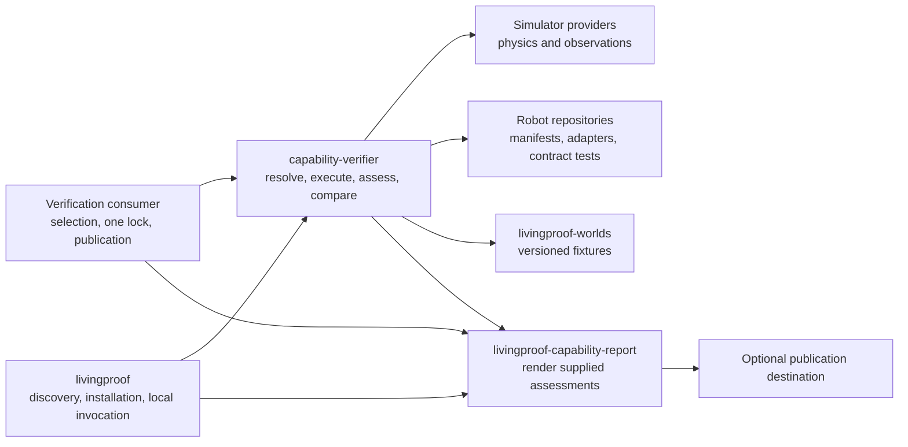
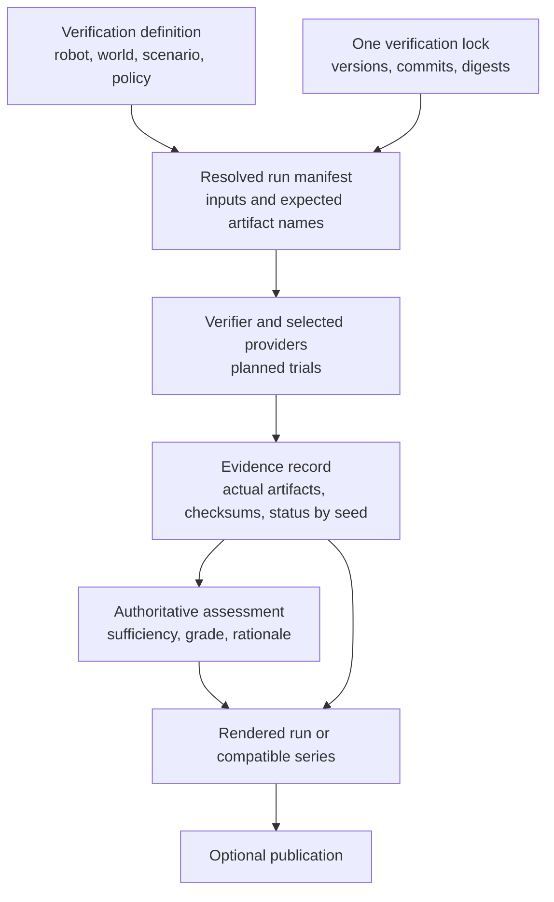

<!-- SPDX-License-Identifier: CC-BY-4.0 -->

# Verification architecture

Living Proof Labs verification turns a selected robot configuration, world,
scenario, and policy into retained evidence, an authoritative assessment, and
a report people can inspect. The same contracts support local development,
automated workflows, and future customer-owned verification projects.

This page describes the current architecture and its tracked migrations. It is
not a claim that every integration or hardware deployment is complete.

## Start here

| Need | Read |
| --- | --- |
| Find the component responsible for a task | [Responsibilities](#responsibilities) |
| Follow a run from selection to publication | [Run and series flow](#run-and-series-flow) |
| Understand what is implemented now | [Current implementation](#current-implementation) |
| Track the remaining migrations | [Migration work](#migration-work) |

## Responsibilities

Arrows show a dependency or supplied input, not ownership of every artifact.
The consumer is intentionally thin: it selects a baseline and publishes
results; it does not copy the execution, evaluation, or rendering engines.

| Component | Responsibility | Boundary |
| --- | --- | --- |
| `.github` | Organization view, inventory, and this architecture | Does not become a verification engine |
| Verification consumer | One selected baseline, verification lock, run/series selection, and publication settings | Planned repository [#11](https://github.com/Living-Proof-Labs/.github/issues/11); [verifier #20](https://github.com/Living-Proof-Labs/capability-verifier/issues/20) designates `capability-verifier/comparisons/` as the temporary location pending implementation |
| Robot repository | Robot manifest, adapter, assets, feature flags, simulator compatibility, and contract tests | Does not own the cross-robot verification baseline after the manifest migration |
| `livingproof` | Discovery, installation, and local invocation of installed tools | Is not a required hop for an automated workflow |
| `capability-verifier` | Resolve the lock, execute trials, retain evidence, and produce authoritative grades and comparisons | Evaluator implementation may become more internally separated; it remains the authority |
| Simulator provider | Physics execution and observations | Does not grade capability |
| `livingproof-worlds` | Versioned fixtures and engine representations | Adapter code performs engine conversion |
| `livingproof-capability-report` | Render supplied run and series assessments | Must not recompute a grade or invent missing evidence |
| `livingproof-common` | Identity and build provenance | Is not a plugin manager, runner, or evaluator |

GitHub Pages is an optional publication destination, not a shared-tool
dependency. Shared capabilities never depend back on a consumer.

## Run and series flow

| Record | What it records | Authority |
| --- | --- | --- |
| Verification definition | Selected robot configuration, world, scenario, policy, and series intent | Consumer |
| Verification lock | Reviewed versions, commits, digests, and compatibility choices | Consumer; verifier #20 designates `capability-verifier/comparisons/` as a temporary future location |
| Resolved run manifest | Exact executable inputs, planned trial identities, and **expected** media/evidence-link artifact names | Verifier |
| Evidence record | **Actual** artifacts, checksums, timestamps, and pass, missing, or error status for every planned seed | Providers and verifier |
| Assessment | Evidence sufficiency, authoritative grade, rationale, and comparison result | Verifier and its evaluators |
| Report | A supplied assessment and linked provenance for one run or a declared compatible series | Reporter |

Pipeline completion, evidence sufficiency, and a capability grade are different
signals. Planned trial count remains the denominator: a missing or errored
trial is listed by seed and is not silently removed from a series.

An evidence checksum, lock hash, and source-run link preserve provenance after
an Actions artifact expires. They do not make expired evidence retrievable.
Long-lived evidence storage is a separate decision.

Series comparison requires compatible inputs, versions, metrics, and
missing-trial treatment. Equal random seeds across engines do not prove equal
physics or results. Simulation evidence applies only to its declared context;
it never authorizes physical deployment.

## Current implementation

Three robot repositories now use the verifier's pinned reusable
`walk-hallway.yml` workflow directly. This is a valid automated entry point;
it plans from the lock, gathers evidence per configuration, verifies, renders,
and publishes the workflow result without an extra command-line hop through
`livingproof`.

| Robot | Merged thin consumer | Verified main workflow |
| --- | --- | --- |
| G1 | [`21c9131`](https://github.com/Living-Proof-Labs/livingproof-unitree-g1/commit/21c9131ca79ea4ec032ad3372408ff38684cf278) | [successful run](https://github.com/Living-Proof-Labs/livingproof-unitree-g1/actions/runs/41338061709) |
| Go1 | [`cb21338`](https://github.com/Living-Proof-Labs/livingproof-unitree-go1/commit/cb21338ec490d0b39133ee6da9bc64a0452dd229) | [successful run](https://github.com/Living-Proof-Labs/livingproof-unitree-go1/actions/runs/41338077952) |
| T1 | [`6d69ff0`](https://github.com/Living-Proof-Labs/livingproof-booster-t1/commit/6d69ff0d48c051e5c39f4834462bf45980d90cfd) | [successful run](https://github.com/Living-Proof-Labs/livingproof-booster-t1/actions/runs/41338094107) |

The reusable workflow and simulator helpers already remove duplicated robot
workflow glue. The remaining migrations below make the one-lock and
verifier-authority boundaries explicit.

`livingproof` remains the local discovery, installation, and invocation layer.
Both its local path and the direct reusable workflow must use the same
contracts and verification engine.

### Open boundaries being migrated

- `livingproof-capability-report` still contains grading and aggregation code.
  [Issue #30](https://github.com/Living-Proof-Labs/livingproof-capability-report/issues/30)
  removes that implementation; the verifier is already the agreed authority.
- Robot repositories still carry `verification.lock.json` files. Their manifest
  and contract-test migrations retire those transitional locks.
- The dedicated verification consumer is not approved yet. Verifier #20
  designates `capability-verifier/comparisons/` as the temporary location for
  its lock; that path is not delivered on the current verifier main branch.

## Migration work

| Change | Tracked work | Result |
| --- | --- | --- |
| Define a generic robot manifest | [robot-capability-specs #27](https://github.com/Living-Proof-Labs/robot-capability-specs/issues/27) | Robots publish what they provide: configurations, adapters, assets, feature flags, and simulator compatibility |
| Own one verification lock | [capability-verifier #20](https://github.com/Living-Proof-Labs/capability-verifier/issues/20) | The verifier resolves manifests and fans trials out and results back in |
| Separate evaluator implementation | [capability-verifier #21](https://github.com/Living-Proof-Labs/capability-verifier/issues/21) | Grading can evolve behind an evaluator interface without a new evaluator repository |
| Render supplied assessments only | [livingproof-capability-report #30](https://github.com/Living-Proof-Labs/livingproof-capability-report/issues/30) | Reporter grading and aggregation are removed; absent assessment data remains explicit |
| Publish robot manifests and contract-test them | [G1 #4](https://github.com/Living-Proof-Labs/livingproof-unitree-g1/issues/4), [Go1 #4](https://github.com/Living-Proof-Labs/livingproof-unitree-go1/issues/4), [T1 #7](https://github.com/Living-Proof-Labs/livingproof-booster-t1/issues/7) | Robot-owned verification locks are retired |
| Add a Gazebo lock variant | [livingproof-sim-gazebo #4](https://github.com/Living-Proof-Labs/livingproof-sim-gazebo/issues/4) | Another simulator can participate through the same lock and adapter contracts |
| Create the dedicated consumer when approved | [.github #11](https://github.com/Living-Proof-Labs/.github/issues/11) | Move the implemented temporary comparison lock into one customer-like verification repository |
| Render Mermaid in the documentation site | [living-proof-labs.github.io #18](https://github.com/Living-Proof-Labs/living-proof-labs.github.io/issues/18) | Separate documentation-site work; GitHub Markdown is the supported renderer for the diagrams above |

Until the manifest migration lands, robot repositories still contain their
existing `verification.lock.json` files. Those are transitional inputs, not a
second long-term baseline. The intended end state is one verification consumer
lock plus robot manifests and contract tests.

## First parity fixture

G1 stock is the first parity fixture. Its reusable workflow must retain the
planned trial count, record each seed's actual evidence checksum, and compare
the resolved inputs, evidence, assessment, and rendered report with the prior
path before replacing it.
