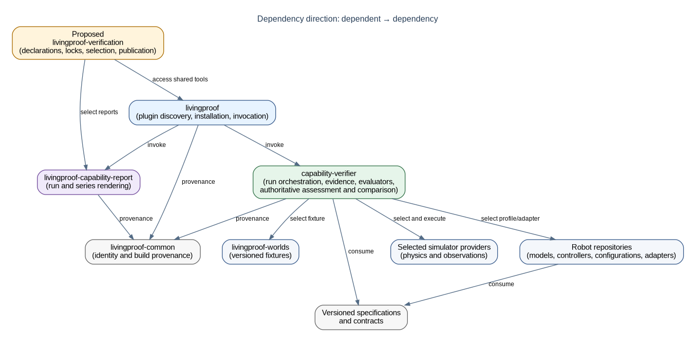
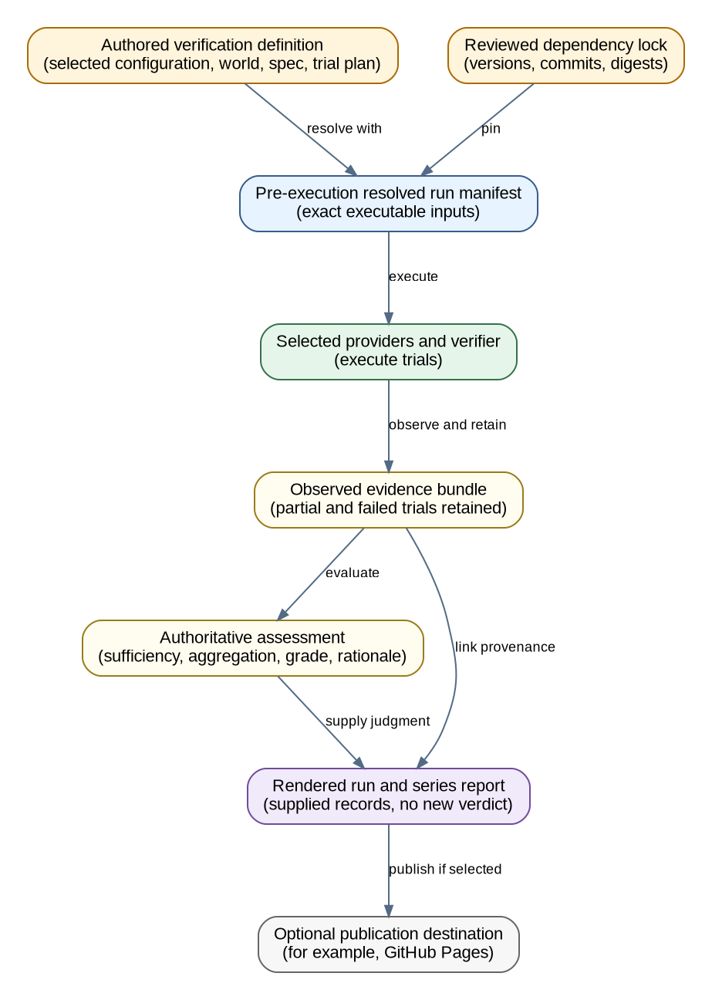

<!-- SPDX-License-Identifier: CC-BY-4.0 -->

# Verification architecture proposal

**Status: proposal under review.** This document describes a target division of
responsibility for Living Proof Labs verification work. It does not create
`livingproof-verification`, move code, alter a repository's settings, or claim
that every integration described here is already available.

The proposed consumer repository is tracked in [issue #11](https://github.com/Living-Proof-Labs/.github/issues/11).
It remains planning-only and unassigned until implementation is explicitly
approved.

## Dependency direction

The editable source is [verification-architecture.dot](verification-architecture.dot).
The rendered SVG is [verification-architecture.svg](verification-architecture.svg).
Every arrow in this diagram means **dependent → dependency**. For example, the
proposed consumer depends on `livingproof`, and the verifier depends on selected
providers, robot profiles, worlds, specifications, and provenance helpers.

## Data and publication flow

The editable source is [verification-data-flow.dot](verification-data-flow.dot).
The rendered SVG is [verification-data-flow.svg](verification-data-flow.svg).

## Design principles

- `.github` owns the organization view, repository inventory, and this
  architecture. It does not become a second verification engine.
- `livingproof` is the lightweight plugin and tool discovery, installation, and
  invocation entry point. It does not own evidence collection, grading,
  simulator orchestration, or reporting decisions.
- `capability-verifier` owns trial execution, orchestration, evidence
  collection, internal evaluators, and the authoritative assessment,
  aggregation, and comparison judgments.
- `livingproof-capability-report` owns reusable run-level and series-level
  rendering and site-generation code. It renders supplied runs and assessments;
  it must not invent missing data or independently change a verdict.
- Providers retain their subject-matter responsibilities. Simulator providers
  execute physics and observations. Robot repositories own models,
  controllers, configuration profiles, adapters, and reference tests.
  `livingproof-worlds` owns versioned fixtures and engine representations.
- `livingproof-common` remains narrow: identity and build provenance, not a
  plugin manager, runner, or evaluator. GitHub Pages is an optional Living
  Proof Labs publication destination, never a shared tool dependency.

## Current and proposed state

Today, the implementation is transitional. Robot-owned workflows and evidence
glue currently compose locked inputs, simulator runs, and verifier calls for
their own profiles. `capability-verifier` provides reference execution,
evidence, and evaluator helpers; it is not yet the fleet-wide orchestrator.
`livingproof-capability-report` currently contains portable rendering **and**
grading/aggregation policy, so authoritative assessment and comparison have not
yet been consolidated in one implementation. The G1 locked workflow is a
useful concrete path: simulator evidence is collected first, verifier helpers
assess it, then the reporter grades and renders the result. These demonstrated
pieces do not claim that every robot, engine, or physical-deployment integration
is complete.

The proposal adds no new evaluator service. It defines a thin,
customer-like `livingproof-verification` consumer, after approval, to hold
declarative verification selections and publication choices. Shared tools stay
in their existing owning repositories. No existing repository deletion is
justified by this proposal.

| Concern | Current owner | Proposed boundary |
| --- | --- | --- |
| Organization inventory and architecture | `.github` | Keep the single ecosystem view here; do not duplicate inventory in a consumer. |
| Plugin/tool access | `livingproof` | Discover, install, and invoke explicitly installed tools; no verification logic. |
| Run composition and execution | Robot-owned workflows and evidence glue, with `capability-verifier` reference helpers | `capability-verifier` orchestrates selected providers and preserves complete trial evidence. |
| Assessments, grades, and comparisons | Verifier evaluators produce assessments; the reporter currently owns grading/aggregation policy | `capability-verifier` becomes the authoritative assessment, aggregation, and comparison authority. A consumer supplies selections and receives results. |
| Physics and raw observations | Selected simulator provider | Execute the engine and emit observations, without grading capability. |
| Robot model, controller, configuration, adapter | Robot repository | Version and test the profile and adapter close to the robot assets. |
| World fixtures and engine representations | `livingproof-worlds` and selected simulator providers | Keep worlds versioned and engine-neutral; keep conversion in adapters. |
| Rendering and publication artifacts | `livingproof-capability-report`, which currently also grades | Render supplied run and series records without changing their judgments. |
| Consumer definitions, locks, selection, publication settings | Proposed `livingproof-verification` | Declarative inputs and thin local/continuous-integration calls only. |

The proposed consumer depends on capabilities; shared capabilities must not
depend back on the consumer. Versioned specifications and contracts are
dependencies of the components that interpret them. The diagram deliberately
has no shared-tool dependency back onto the proposed consumer, and GitHub Pages
is not a dependency of any shared tool, provider, evaluator, or reporter.

`livingproof-verification` would access the verifier and reporter through
`livingproof`. The verifier selects the relevant providers and evaluator
responsibilities for a run. The reporter supplies both individual-run and
series views; the consumer selects the runs, series policy, and optional
publication destination.

The data-flow view keeps intent, resolved inputs, observations, authoritative
judgment, and presentation separate. It is not a dependency graph: records
move forward through the path, while the underlying tools remain independently
versioned capabilities.

## Records and authority

These records are distinct and must retain their own identity and provenance.

| Record | Created when | Authority and content |
| --- | --- | --- |
| Verification definition | Before a run | Human-authored declarative selection of robot configuration, world, simulator, specification, trial plan, and intended series policy. |
| Dependency lock | Before a run | Reviewed versions, commits, digests, and compatible tool/provider references. It is not observed evidence. |
| Resolved run manifest | Immediately before execution | The verifier resolves the definition and lock into the exact executable inputs, including selected configuration, provider, evaluator/policy versions, and trial identities. |
| Evidence bundle | During execution | Providers and the verifier preserve observed files, digests, timestamps, trial status, and provenance. Partial, missing, and failed trials remain represented. |
| Authoritative assessment | After evaluation | `capability-verifier` records evaluator outputs, sufficiency, aggregation, grade, and rationale. The report does not recalculate or replace this judgment. |
| Rendered report | After assessment | The reporter renders a supplied run or declared compatible series, with links to its manifest, evidence, and assessment. |

Pipeline success, evidence sufficiency, and capability grade answer different
questions. A completed pipeline can have insufficient evidence. A failed or
partial trial cannot be silently removed to make a series look successful.

Series comparison requires declared compatibility rules for inputs, versions,
metrics, and missing-trial treatment. Equal random seeds across engines do not
establish equivalent physics, observations, or capability results. Simulation
results are evidence for the declared simulation context; they never authorize
physical deployment.

## G1 configuration-change journey

1. A maintainer changes a versioned G1 controller or configuration profile in
   `livingproof-unitree-g1`, preserving its adapter and reference tests.
2. A review updates the consumer's verification definition and dependency lock
   to select the intended G1 configuration, world, specification, simulator,
   and trial plan.
3. The same local and continuous-integration entry point invokes the shared
   path through `livingproof`, then `capability-verifier`; it does not copy a
   runner into the consumer.
4. Before trials start, the verifier saves the resolved run manifest. Selected
   simulator helpers produce observations; the verifier retains evidence for
   every planned trial, including failed and incomplete trials.
5. The verifier records authoritative assessments and the declared aggregation
   result. The reporter renders the supplied run and any declared compatible
   series. Publication settings may select GitHub Pages, but that selection
   does not affect execution or judgment.
6. A maintainer can compare provenance-linked reports to decide what to improve.
   No simulation report is a physical-deployment authorization.

## Migration stages

1. **Contract review.** Publish and review this boundary, record schemas for
   the six records above, and identify which existing verifier workflow and
   simulator helpers provide each step. No new repository is required.
2. **Parity fixture.** Reproduce one existing, released fixture through the
   same local and continuous-integration tool path. Compare resolved inputs,
   evidence digests, assessments, and rendered output with the existing path.
3. **Thin consumer, if approved.** Create `livingproof-verification` only after
   issue #11 is approved. Add declarative definitions and locks, not copied
   orchestration, evaluator, simulator, or report code.
4. **Explicit series policy.** Add run selection and compatibility policies.
   Preserve partial and failed trials in a series instead of filtering them out.
5. **Publication choice.** Configure a Living Proof Labs Pages destination only
   where wanted. Keep the report artifacts portable so another consumer can
   publish elsewhere.

Each stage must preserve existing evidence parity before it replaces a path.
The local and continuous-integration interfaces must exercise the same shared
tool path. Migration does not require moving execution into `livingproof`.

## Review questions

- Are the six record boundaries sufficient to diagnose a result without
  conflating intent, resolved inputs, evidence, assessment, and presentation?
- Which existing verifier workflow and simulator helpers should form the first
  parity fixture?
- What compatibility and missing-trial policy is required before the first
  series comparison?
- Which report artifacts and provenance links should remain available after a
  publication destination expires?
