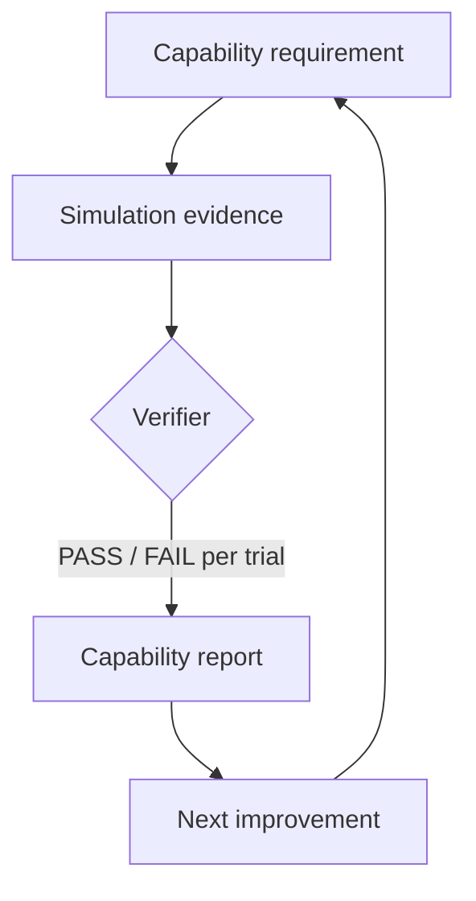

<!-- SPDX-License-Identifier: CC-BY-4.0 -->
# Contribute

Bring a concrete question: what should the robot do, under which conditions,
what did you observe, and which versions were involved? Small, inspectable examples
help us identify a requirement, evidence gap or useful next integration.

## Choose the owner

- For a capability requirement, start with the [specifications manual](https://docs.livingprooflabs.com/robot-capability-specs/).
- For fixture execution or evidence collection, use the [verifier manual](https://docs.livingprooflabs.com/capability-verifier/).
- For grading and report behavior, use the [reporter manual](https://docs.livingprooflabs.com/livingproof-capability-report/).
- For commands, plugins and installation, use the [LivingProof manual](https://docs.livingprooflabs.com/livingproof/).
- For this introduction, terminology, architecture or directory, [open an organization documentation issue](https://github.com/Living-Proof-Labs/.github/issues).

Read the [shared contribution manual](https://docs.livingprooflabs.com/collaboration-guidelines/)
for orientation. This content repository explicitly adopts
[guidelines v6.0.0](https://github.com/Living-Proof-Labs/collaboration-guidelines/tree/v6.0.0),
with local instructions in its [working agreement](../AGENTS.md).
Current manual links are reading destinations, not floating dependency pins.

## Improve this site

The pages are authored in `.github/docs/`, the single source; the
[root site repository](https://github.com/Living-Proof-Labs/living-proof-labs.github.io)
only builds and publishes them. [`site.json`](site.json) lists the published
pages, their navigation order and redirects for moved URLs; the project and
manual tables come from [`directory.json`](directory.json), which may name only
repositories in the [inventory](../config/github/repositories.json). Edit those
files, not the published site.

Run `task docs:check` before opening a pull request: it fails on a missing page,
a broken local link or fragment, a directory entry outside the inventory, or a
Mermaid block the site cannot theme. The pull-request workflow also builds the
pages with the root site's own build and checks at a pinned publisher revision.
After merge, the root site repins to the new revision in its own reviewed pull
request; publication is a separate, authorized step.

Keep organization vision here and product instructions with their owner.
Preserve existing URLs and anchors, or add a redirect in `site.json`. Keep current
behavior, evidence limitations and planned integrations explicit. Check a new
manual live before listing it.

## Draw diagrams with Mermaid

Write diagrams as ordinary fenced `mermaid` blocks. The same source renders as a
diagram on the documentation site and in GitHub's Markdown view, so there is no
Graphviz to install and no generated PNG or SVG to commit.

Keep to what both renderers support:

- Use `flowchart`, `sequenceDiagram`, `stateDiagram-v2`, `classDiagram` or
  `erDiagram`; the site styles these for light and dark mode, and
  `task docs:check` rejects other types.
- Do not add `%%{init: ...}%%` themes, colors or fonts; the site and GitHub apply
  their own light and dark styles.
- Keep diagrams small enough for a phone: the site scales a wide diagram down to
  the screen, so labels shrink. Prefer top-to-bottom (`flowchart TD`), short node
  labels with detail in the text, a fan-out drawn `LR` so it stacks, and split a
  large diagram in two. The publisher's browser test fails below about 12 px
  effective label size on a 390 px screen.
- The site renders with the Mermaid 12.2.0 it vendors; GitHub uses its own bundled
  Mermaid, which may be a different version. Check a new diagram in the pull
  request's GitHub file view as well as in the publisher's docs preview, which
  fails if a block is left as code.

## Apply the shared look to a project manual

Each project manual has its own Zensical configuration, so the brand is not
inherited automatically. To make a manual match livingprooflabs.com and this
site, copy the pinned stylesheet, then the favicon and header logo from the
root site repository, and change that project's `mkdocs.yml` only:

1. Copy [`brand/docs/brand.css`](https://github.com/Living-Proof-Labs/collaboration-guidelines/blob/v7.5.0/brand/docs/brand.css)
   from collaboration-guidelines at the tag recorded in the publisher's
   [`docs-brand.lock.json`](https://github.com/Living-Proof-Labs/living-proof-labs.github.io/blob/main/docs-brand.lock.json).
   The lock's `version` field is that tag (`v7.5.0`) and its `path` field is
   `brand/docs/brand.css`. Place the file in the manual's docs directory (for
   example `docs/assets/brand.css`) and list it under `extra_css`.
2. Copy [`docs/favicon.svg`](https://github.com/Living-Proof-Labs/living-proof-labs.github.io/blob/main/docs/favicon.svg)
   next to it and set `theme.favicon` to its path.
3. Copy [`docs/overrides/partials/logo.html`](https://github.com/Living-Proof-Labs/living-proof-labs.github.io/blob/main/docs/overrides/partials/logo.html)
   into the manual's theme override directory (`theme.custom_dir`; create one if
   the manual has none) so the header shows the robot-face logo.
4. Add `primary: custom` and `accent: custom` to every `theme.palette` entry so
   the teal colors apply in light and dark mode.
5. Add a link back to the website, for example
   `copyright: '<a href="https://livingprooflabs.com/">Back to livingprooflabs.com</a>'`.

Keep `theme.font: false`; `brand.css` loads DM Sans and Instrument Serif itself.

## Licensing and help

See [license scopes](https://docs.livingprooflabs.com/license.html) before reusing content. The adapted vision retains
its original Apache-2.0 attribution; other original prose is CC BY 4.0.
Use public issues for documentation corrections. No private security reporting
route is documented for organization documentation; do not put sensitive reports in a
public documentation issue.
