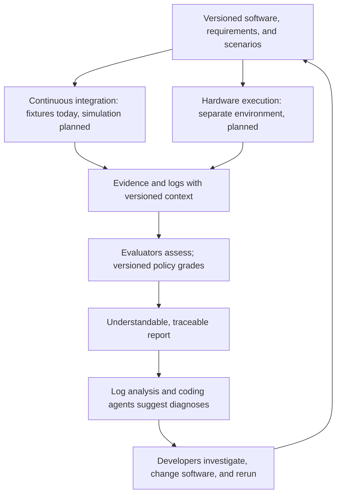

# Helping robots help humans

> [!NOTE]
> **Under construction · Updated 26 October 2026**
> We are building toward the workflow below. Today's releases demonstrate fixture
> evidence and reports; robot, simulator, and live evaluator integrations are still
> ahead. Expect small, inspectable examples while the pieces take shape.

Robots earn our confidence through what they can do, under conditions we can
understand. **Living Proof Labs is building an open way to connect robot capability
requirements, observed behavior, and evidence people can inspect.**

Imagine a developer asking: *Does this robot pause when asked? How quickly? What
changed after the last software update?* We want the answer to lead from a clear
requirement to a run, its evidence, and a useful next step.

## From a requirement to the next improvement

**Continuous integration is the execution platform we are building toward for
simulation verification:** software changes trigger repeatable scenarios, evidence
capture, and reports. Today's fixtures already run in continuous integration;
simulator adapters are future work. Physical robot runs need their own hardware
execution environment and controls. We do not control hardware from continuous
integration today.

This is the intended loop, with future execution paths marked explicitly:



Deterministic checks, human review, and agent-assisted evaluations should retain
separate assessments and disagreements. An explicit policy determines the grade.
Log analysis and coding agents then help developers investigate possible root
causes and test improvements, comparing each new run in its exact context.

An evaluation asks whether evidence meets a requirement. A diagnosis suggests why
something happened: it is a hypothesis to investigate, not proof of root cause or
authority to change a grade. These reports do not certify robot safety. Our vision
spans diverse robots, simulators, evaluation providers, and developer tools;
those connections are not claims of implemented integrations or partnerships.

## What goes in, what comes out

| Piece | What it means |
| --- | --- |
| **Specification** | The versioned capability requirement, operating conditions, and acceptance criteria: what must be true. |
| **Scenario** | A concrete situation and expected behavior used to exercise that requirement. |
| **Evidence and manifest** | Observations and logs are the evidence. A manifest indexes result context, specification and software versions, assessments, and relative evidence paths with integrity digests. It describes collected results, not commands for a robot. |
| **Assessments** | Evaluators' findings, reasons, and evidence references, kept separately so disagreement stays visible. |
| **Policy** | Explicit, versioned rules that turn supported assessments and evidence checks into a grade. Missing evidence must not silently pass. |
| **Report and grade** | The understandable record of decisions and their supporting context. The grade is an outcome within that report; rendering a saved report does not regrade it. |

The released [portable bundle schema](https://github.com/Living-Proof-Labs/livingproof-capability-report/blob/v1.6.0/src/livingproof_capability_report/bundle.schema.json)
provides the technical detail. A manifest can contain multiple results, so a
bundle need not represent a single robot execution. Keep its referenced evidence
files with it; different specification and software contexts remain separate in
grading.

In a reporting workflow, the execution pipeline supplies the manifest, evidence,
and assessments. The installed reporter validates that input, grades under its
supported policy, and renders the stored decisions. Our examples supply recorded
fixtures in place of observations from a robot or simulator.

## See it today

Here is a plain-language reading of the released pause fixture, not a live robot
run or an executable command:

```text
Given motion is inhibited after a recorded pause of 300 milliseconds
When that evidence is assessed against a 500-millisecond pause limit
Then the fixture passes
When the same evidence is assessed against a 250-millisecond pause limit
Then the fixture fails
And the report retains the requirement versions and supporting evidence
```

The observation has not changed; the requirement has. Missing elapsed time instead
produces insufficient evidence. Today's demonstration uses deterministic checks,
scripted mock agent assessments, and recorded human assessments. No simulator,
robot, model call, or live human review is involved.

**Download a complete example** from [capability verifier v1.3.0](https://github.com/Living-Proof-Labs/capability-verifier/releases/tag/v1.3.0):

- [Baseline pass](https://github.com/Living-Proof-Labs/capability-verifier/releases/download/v1.3.0/capability-verifier-v1.3.0-baseline-22ce11f3-4bbe-5ee8-b0cf-a357ad5e41a8-amd64-40284818922-1.zip): 120 milliseconds meets the 500-millisecond limit.
- [Stricter requirement](https://github.com/Living-Proof-Labs/capability-verifier/releases/download/v1.3.0/capability-verifier-v1.3.0-strict-8099ea9d-76e0-577f-bdda-1609583bcbce-amd64-40284818922-1.zip): 300 milliseconds exceeds the 250-millisecond limit.
- [Required behavior fails](https://github.com/Living-Proof-Labs/capability-verifier/releases/download/v1.3.0/capability-verifier-v1.3.0-negative-191b6fd4-68bc-5f57-b485-6a8bb02379e0-amd64-40284818922-1.zip): motion is not inhibited; favorable assessments cannot hide the failure.
- [Missing measurement](https://github.com/Living-Proof-Labs/capability-verifier/releases/download/v1.3.0/capability-verifier-v1.3.0-missing-measurement-61961d98-eace-51eb-8983-7b252aa89bf7-amd64-40284818922-1.zip): absent elapsed time leaves insufficient evidence.
- [Compatibility comparison](https://github.com/Living-Proof-Labs/capability-verifier/releases/download/v1.3.0/capability-verifier-v1.3.0-compatibility-matrix-762ce2a2-703e-53de-9598-ff79388e0053-amd64-40284818922-1.zip): four requirement/executor combinations show passes, a failure, and an unsupported pairing.

Unzip any example into its own folder and open `report.html`. Each archive keeps
its manifest, evidence, reports, provenance, checksums, and regeneration instructions
together. These are portable data bundles; the architecture in a filename records
where it was built, not a restriction on where you can read it.

The [download catalog](https://github.com/Living-Proof-Labs/capability-verifier/releases/download/v1.3.0/CATALOG.md)
maps the examples, and [published checksums](https://github.com/Living-Proof-Labs/capability-verifier/releases/download/v1.3.0/BUNDLE-SHA256SUMS)
let you check download integrity. Reports preserve their recorded specification
versions and keep different contexts separate; there is no combined grade.

## Find your next step

Start with the part that interests you. These links open released documentation;
installation commands and technical details live with the tools.

| If you want to… | Start here |
| --- | --- |
| Install tools and manage the reporter plugin | [Living Proof command, v1.4.0](https://github.com/Living-Proof-Labs/livingproof/tree/v1.4.0) |
| Explore capability requirements and examples | [Robot capability specifications, v1.2.1](https://github.com/Living-Proof-Labs/robot-capability-specs/tree/v1.2.1) |
| See how fixtures become portable evidence | [Capability verifier, v1.3.0](https://github.com/Living-Proof-Labs/capability-verifier/tree/v1.3.0) |
| Understand grading and report formats | [Capability reporter, v1.6.0](https://github.com/Living-Proof-Labs/livingproof-capability-report/tree/v1.6.0) |
| Build on shared version-identification tools | [Common library, v1.0.0](https://github.com/Living-Proof-Labs/livingproof-common/tree/v1.0.0) |

Have a capability you need to explain, a confusing result, or an integration you
want to explore? Bring a concrete example to the relevant repository's Issues tab.
Tell us what you expected, what you observed, and which versions were involved.
Small, inspectable examples help us build this together.
